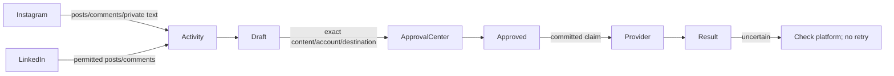
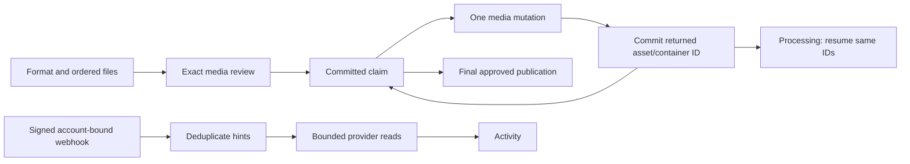

# Instagram and LinkedIn social workspace

User scope: Instagram private messages plus public social activity; LinkedIn
company Pages **and** personal profiles. Keep concise controls and do not modify
Omnichannel/Telegram source. Existing messaging outbox does not model public
publishing, so `omni_social` owns social review and execution; `omni_instagram`
and `omni_linkedin` supply fixed API clients. No existing connector source changes.

Screens: Activity, Publishing, Accounts. Native Odoo sheet/list controls remain.
An account connection verifies the profile; it does not promise every API
permission. Reads show unavailable capabilities. Personal LinkedIn reads need
restricted access; no LinkedIn DM API is offered.

Initial supported publishing: Instagram single JPEG photos and text replies to
comments/private messages; LinkedIn text posts and text public replies. Engagement
counts accompany imported posts. Latest bounded snapshots are synced on explicit
manager action; this is not a webhook stream or complete historical archive.
Reels, stories, carousels, ads, full analytics, scheduled posting, media replies,
and bulk actions are outside this initial release.

Private Instagram replies need explicit recipient agreement and a verified recent
incoming conversation within the 24-hour window; blocked identities stay blocked.
Every outbound action requires a separate assigned approver and current policy.
Photos are stored immutably in the draft; their hash is frozen in review. Meta can
fetch only a token-addressed JPEG during a live approved publishing claim; the URL
expires with review. This avoids fetching arbitrary media URLs inside Odoo.

Claims commit before network calls. Instagram container creation is one durable
stage; a later explicit Publish resumes that container, checks processing status,
and makes at most one final publish POST. Pending or unknown claims cannot repeat.
A process crash leaves Publishing and requires platform inspection. No automatic
retry, scheduler or public test post is enabled. Rejected actions remain retained;
a new draft needs new review. Approval/configuration/consent changes invalidate
future claims, but cannot recall an already claimed external request.

## Media and webhook extension

Supported formats now include Instagram JPEG photos, mixed 2–10 item carousels,
MP4 reels and photo/video stories (business accounts), plus LinkedIn single JPEG
and 2–20 image organic MultiImage posts. Files and order are included in approval.
Existing single-photo drafts remain supported. Ads, LinkedIn Instagram-style
stories/reels, scheduling and unsolicited private messaging remain outside scope.

Preparation proceeds automatically within the explicit Publish action, with each
stage committed separately; it stops on processing, uncertainty or a 40-second
budget between stages. There is no outbound scheduler. Media URLs cease serving
after sent/failed/cancelled/expired or account revision changes. Reels are also
identified in incoming media; active stories are read from the stories edge.

Webhooks: manager enters the app secret in an ephemeral password input; it goes
into the encrypted account vault. The callback/verify token is shown for developer
portal registration. Registration/subscription creation remains external, not an
automatic promise. LinkedIn supports approved Page social-action notifications,
not personal profile webhooks. Signed notifications are account/subscriber scoped,
deduplicated, and queue bounded read-only sync. The queue retains only digests,
not raw private payloads, for 90 days. It coalesces events; it is not a complete
historical event archive and does not reconcile deleted comments. Manual sync
remains available for recovery. Tokens or app permission loss can stop reads.
