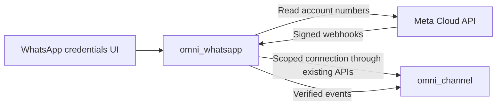

# WhatsApp addon — 2026-10-11

Plan status: **Complete — current scope closed by the user on 2026-10-12.**
Deferred work and verification gaps below remain recorded for future plans.

Current status: offline verification of the implemented inbound/test v1 is
complete. See `addons/omni_whatsapp/VERIFICATION.md` for exact evidence and gaps.
The complete two-way WhatsApp integration remains unfinished; business dispatch
is disabled. Live-account acceptance is deferred because the user has no
WhatsApp Business account. Do not silently classify either gap as a passed test.

## User boundary

Create `addons/omni_whatsapp`. Before editing or changing behavior of
`omni_channel` or `omni_telegram`, present evidence, a concise explanation,
a UI mock and a diagram. This plan does not authorize changing those addons.
Initial onboarding: existing Meta Cloud API account plus Create a Meta app link.

## First implemented slice

Standalone module and pure webhook helpers. No registry, routes, UI, ORM data,
live credentials or sending enabled. Synthetic protocol tests only.

## Verified existing interfaces

- Odoo 20 `odoo/modules/module.py`: manifests, explicit dependency, addon discovery.
- `omni_channel/providers/base.py`: owned adapter registration and release capabilities.
- `omni_channel/providers/inbound.py`: raw-byte verification precedes decoding,
  bounded normalized events, processing through the existing intake layer.
- `omni_channel/controllers/inbound.py`: current callback permits POST only.
- `omni_channel/models/channel_setup.py`: provider actions are override points;
  unsupported guided setup currently raises a clear error.
- Meta's webhook protocol also needs a GET challenge. The Meta app secret signs
  POST payloads; the separate verify token authenticates the GET handshake.

## Next slices, not implemented

1. Review minimal credentials and callback UI mock. Show integration diagram.
2. Add scoped, protected credentials and read-only phone verification in this addon. **Implemented and checked in third slice.**
3. Add provider-specific GET verification route and signed POST intake; use core
   policy, scope, audit and deduplication. Do not acknowledge dropped batches.
4. Test manager/operator/company boundaries, credentials replacement and replay.
5. Add a short tester flow respecting WhatsApp template/session restrictions;
   no Telegram diagnostic-policy reuse. Sending requires its reviewed policy.
6. Mount actual Odoo 20 UI, test clean install and core/Telegram regressions before
   registering a live adapter or reporting the integration as ready.

## Second slice — read-only verification and proposed UI

- Implemented a fixed-host GET client and account-number discovery. One number
  can be selected automatically; multiple numbers require an explicit choice.
- Added 12 fake-HTTP tests (28 total with webhook tests). No live network calls.
- Credentials mock: Access token, Business account ID, Verify account, then
  discovered Phone number selection. Create a Meta app links to Meta.
- Meta app secret and GET verify token belong to receiving setup, not credentials.
- Evidence: Meta's official collection documents
  `GET /{WABA-ID}/phone_numbers` with bearer authentication and the number's
  `id`, `verified_name` and `display_phone_number`:
  https://www.postman.com/meta/whatsapp-business-platform/documentation/wlk6lh4/whatsapp-cloud-api?entity=request-13382743-eb9a6721-1056-4db2-b00a-2290e04b5b5d
- UI wiring is not implemented. Addon models, credential persistence, callback
  routing, intake and sending remain pending. No protected addon files changed.
- Headless mock checks passed: initial hidden number selector, explicit number
  choice, edited-credential invalidation, invalid account input, Next feedback,
  desktop/mobile layout and no JavaScript errors. This verifies the proposed mock,
  not a mounted Odoo view. Version `20.0.0.2.0` manifest and package import passed.

### Proposed integration boundary

Future model/view extensions would live in `omni_whatsapp`, be conditional on
the WhatsApp channel type, and use existing core scope and action checks.
They must not override Telegram behavior. This is the evidence and proposed
boundary for the mock review, not a claim that UI integration already exists.

## Third slice — actual Credentials UI

- Implemented the approved two-input Credentials layout as an Owl 3 field,
  followed by verified phone-number selection. The Create a Meta app link remains.
- The addon extends the setup form/controller only for WhatsApp. Existing addon
  files are unchanged. Other providers delegate to the original controller/action.
- Verify reads account data only. Next re-verifies membership, locks/rechecks
  channel scope, encrypts the token into private files and creates a draft account
  through existing scoped ORM/action mechanisms. No receiving or sending enabled.
- Saved connections show verified account/number details instead of requesting
  secrets again. This is a saved-state presentation, not another setup step.
- API version is an administrator deployment setting, not a user-facing field.
- Actual Odoo 20 `useProps`, `onWillUnmount`, template inheritance, field registry,
  scoped ORM, `models.Constraint` and transaction rollback callbacks checked.
- Installed the addon in the local development database; combined view validated.
- 36 pure tests pass. Rollback database checks pass for roles, team/company scope,
  forged metadata/defaults, token secrecy, selected number, repeat replacement,
  completing Credentials and leaving dispatch/intake off. SMTP, signup and Meta
  calls were blocked in those checks.
- Actual component mounted with bundled Owl 3; inherited setup template compiled
  using the native inheritance engine. Single/multiple number choices, stale
  responses, draft clearing, Next and non-WhatsApp delegation pass.
- Actual component rendered with the local Odoo stylesheet and desktop/mobile
  overflow checks. This is a component rendering with fake service data, not a
  complete logged-in browser tour or a live Meta verification.
- Still pending: webhook configuration/intake, delivery testing, sending policy,
  test message, full logged-in UI tour and production/release capability checks.

Direct Meta docs were rate-limited during research; official Meta samples,
the Meta Postman reference and archived Meta SDK docs supplied protocol evidence.
Current onboarding, Graph version and sending rules must be verified before
network or runtime implementation. No unverified API version is hardcoded.

## Fourth slice — Connect & verify

- Showed a compact connection mock and integration diagram before extending the
  shared setup behavior. Implementation remains entirely in `omni_whatsapp`.
- Added the Meta GET verification handshake without changing the core POST route.
  Actual Odoo routing map resolves GET to WhatsApp and POST to existing intake.
- Generated the verify token, encrypted the app secret and displayed the callback
  as an editable field. Configuration remains manual in Meta; Save webhook makes
  no provider-side change and never implies registration.
- Registered a module-owned inbound-only adapter. Existing endpoint/policy actions
  authorize receiving; original durable event deduplication and inbox processing
  handle signed private text. Foreign WABA/phone batches fail closed. Media, group
  content and delivery receipts are outside this release's private-text intake.
- URL/secret edits clear verification, disable receiving and reset progress from
  Connect & verify. Direct forged fields and unauthorized edits are rejected before
  elevated writes. Committed references are checked before vault-file cleanup,
  because Odoo commit callbacks survive nested savepoint rollbacks.
- Finish setup is blocked while test sending is missing. Dispatch stays off.
- 37 pure tests and 10 existing core/Telegram view checks passed. Actual Credentials
  and receiving Owl components passed, including inherited-template compilation,
  native retention saving, failed-save/RPC recovery and secret cleanup. Native
  combined view validated on WhatsApp-only module upgrade.
- Rollback-only database checks passed for the new callback and signed intake,
  including public-user transport, scoped access, duplicate retries, conversation
  creation and progress invalidation. No live Meta calls or emails permitted.
- New code needs an Odoo restart. The existing localhost server has no process or
  app terminal accessible from this execution environment, so it was not restarted.
- Remaining: test sending, final activation, full logged-in wizard/card review,
  live credentials/tunnel/delivery verification and shared callback routing.

## First-slice evidence (historical)

- Base repository commit inspected: `3c00b418bf90`.
- Protocol tests: 16 passing, including Unicode failures and scope rejection.
- Actual Odoo 20 `Manifest` validated the manifest; addon package imported.
- `git diff --check` passed. No files changed in either protected addon.
- No database installation, UI rendering, runtime intake or sending claimed.

## Fifth slice — fixed setup test and completion

- Presented a compact tester/message mock and execution diagram before adding
  the final step. Implementation remains in `omni_whatsapp`; both protected
  addons have no source diff against HEAD.
- Final native view shows Tester phone, the fixed short message, one confirmed
  send action, and receipt confirmation. Finish stays disabled until confirmation.
- The tester must have a recent, verified private incoming message from the exact
  current endpoint/policy. Blocking, manager/team/company scope and immutable
  attempted recipients are enforced before any POST.
- The public action commits an actor-audited attempt before sending. Confirmed
  rejection allows an explicit new attempt; pending, accepted and uncertain
  results suppress duplicate sends. Transport uses a fixed Graph host, verified
  TLS, no proxies/redirects/retries, bounded response size and elapsed stream time.
- Human receipt confirmation plus the current credential/callback/tester
  fingerprint authorizes native sender selection and 5/5. Business dispatch stays
  off. Withdrawing receipt removes the final milestone. Resolved configuration
  changes deactivate the selected number and clear dependent progress; unresolved
  attempts cannot be discarded to authorize another send.
- 44 synthetic protocol/vault/transport tests pass; 6 core and 4 Telegram view
  regressions pass. Both existing actual Owl component checks pass, including
  the updated primary setup template compilation. WhatsApp-only v5 upgrade and
  combined native form validation passed.
- Rollback-only ORM checks pass for the diagnostic, public-action ordering,
  duplicates, uncertain outcomes, receipt withdrawal, current completion and
  callback changes after completion. Cursor/commit boundaries are injected for
  the public-action check; separate-session transaction concurrency is not claimed.
  Both GET/POST Meta calls and all emails are blocked. No real message was sent.
- Remaining: restart the user's running Odoo process, full logged-in final-screen
  review, live Meta/tunnel/delivery verification, approved business reply sending,
  templates/media, shared callback routing and interrupted-attempt reconciliation.
  This is implemented onboarding with a diagnostic, not a complete production
  WhatsApp business messaging release.
